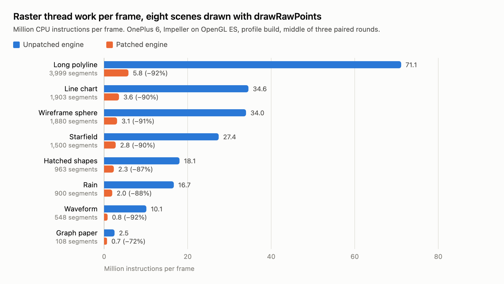
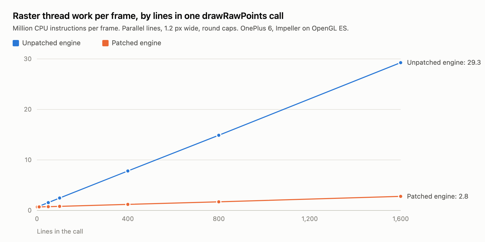
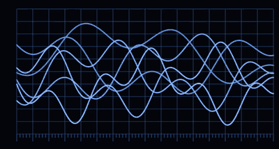
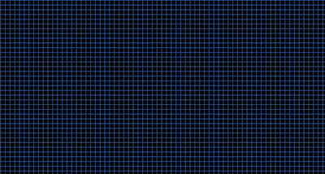
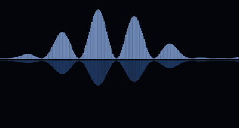
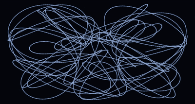

# Flutter line batch bench

A small Flutter app and a runner that measure what it costs to draw straight lines, by the way the lines are handed to the engine. It draws nothing else, so the numbers are about lines only.

It was written to measure one thing in Impeller: `Canvas.drawPoints` and `Canvas.drawRawPoints` with `PointMode.lines` or `PointMode.polygon` are one call from Dart, but the engine turns them back into one draw call per segment. A patch that draws them with a single draw call is on this branch:

https://github.com/Pomis/flutter/tree/impeller-batch-drawpoints-lines

## What it shows





Measured on a OnePlus 6 (Snapdragon 845, Adreno 630, Android 10, 60 Hz). Impeller uses its OpenGL ES backend on this phone. Flutter master at `2331a7f`, engine built locally with and without the patch, profile mode.

## The scenes

Eight small drawings of the kind apps make out of lines, all drawn with `drawRawPoints`, all moving every frame. These are recordings from the phone:

| | |
|---|---|
|  |  |
| **Hatched shapes**: clipped runs of parallel lines, some cross-hatched | **Line chart**: a grid, tick marks and six series as polylines |
|  |  |
| **Graph paper**: thin level and upright lines | **Waveform**: upright bars and their reflection |
|  |  |
| **Starfield**: short streaks in three layers | **Wireframe sphere**: a turning sphere as mesh edges |
|  |  |
| **Long polyline**: one self-crossing curve of 4,000 points | **Rain**: slanted drops in two layers |

Besides the scenes there is a `lines` scenario: one set of plain lines whose number, cap, width, layout and way of drawing are set one at a time.

## Results

Unpatched against patched engine, 37 scenarios, three rounds, the two engines alternating. Instructions are millions per frame on the raster thread. CPU time is the raster thread's own time per frame. All 37 scenarios produced the same pixel hash on both engines.

### The same 800 lines, five ways, on stock Flutter

Million raster thread instructions per frame, with the frames per second the phone delivered. One `drawRawPoints(PointMode.lines)` call costs the same as 800 `drawLine` calls on every Impeller version measured. 3.50.0 made each draw cheaper and kept the per-segment loop. The last two columns are the locally built engine from the paired run below.

| Way of drawing 800 lines | Flutter 3.47.7 | Flutter 3.50.0 | 3.50.0, Impeller off | master, unpatched | master, patched |
|---|---|---|---|---|---|
| empty frame | 0.61 (60 fps) | 0.61 (60 fps) | 0.31 (60 fps) | 0.66 | 0.66 |
| 800 drawLine calls | 17.07 (59 fps) | 12.66 (59 fps) | 65.90 (45 fps) | 15.01 | 15.01 |
| 800 in one drawRawPoints | 16.96 (59 fps) | 12.54 (59 fps) | 64.70 (47 fps) | 14.89 | 1.71 |
| 800 as one stroked path | 1.72 (59 fps) | 1.73 (60 fps) | 125.60 (36 fps) | not run | not run |
| 800 as one drawVertices | 0.66 (59 fps) | 0.66 (60 fps) | 0.46 (60 fps) | 0.71 | 0.72 |

"Impeller off" is the same 3.50.0 build started with `--ez enable-impeller false`, which falls back to the old Skia renderer. It is slower still on this test, so the old renderer is not a way around it.

### Scenes

| Scenario | Segments | Instructions, unpatched | Patched | Change | CPU ms, unpatched | Patched | fps, unpatched | Patched |
|---|---|---|---|---|---|---|---|---|
| Hatched shapes | 963 | 18.06 | 2.33 | -87% | 10.3 | 3.3 | 59.7 | 59.5 |
| Line chart | 1,903 | 34.55 | 3.57 | -90% | 12.0 | 4.1 | 59.6 | 59.5 |
| Graph paper | 108 | 2.51 | 0.70 | -72% | 3.3 | 2.0 | 59.5 | 59.5 |
| Waveform | 548 | 10.13 | 0.85 | -92% | 8.7 | 2.1 | 59.6 | 59.5 |
| Starfield | 1,500 | 27.43 | 2.78 | -90% | 11.1 | 3.5 | 59.6 | 59.5 |
| Wireframe sphere | 1,880 | 33.97 | 3.11 | -91% | 11.6 | 3.9 | 59.6 | 59.5 |
| Long polyline | 3,999 | 71.12 | 5.84 | -92% | 23.2 | 5.9 | 40.0 | 59.6 |
| Rain | 900 | 16.70 | 1.96 | -88% | 10.0 | 2.9 | 59.6 | 59.5 |

### Plain lines, one property changed at a time

800 parallel lines, 1.2 px wide, round caps, 70% opaque, unless the row says otherwise.

| Scenario | Segments | Instructions, unpatched | Patched | Change | CPU ms, unpatched | Patched | fps, unpatched | Patched |
|---|---|---|---|---|---|---|---|---|
| 2 lines | 2 | 0.69 | 0.68 | -1% | 2.1 | 2.0 | 59.5 | 59.5 |
| 10 lines | 10 | 0.85 | 0.69 | -18% | 2.2 | 2.1 | 59.5 | 59.5 |
| 50 lines | 50 | 1.56 | 0.74 | -52% | 2.6 | 2.0 | 59.6 | 59.5 |
| 100 lines | 100 | 2.46 | 0.81 | -67% | 3.3 | 2.1 | 59.6 | 59.5 |
| 400 lines | 400 | 7.81 | 1.20 | -85% | 7.3 | 2.4 | 59.6 | 59.6 |
| 800 lines | 800 | 14.89 | 1.71 | -89% | 9.8 | 2.8 | 59.6 | 59.6 |
| 1600 lines | 1,600 | 29.26 | 2.78 | -91% | 11.4 | 3.7 | 59.5 | 59.5 |
| 800, butt caps | 800 | 14.36 | 0.91 | -94% | 9.7 | 2.2 | 59.5 | 59.5 |
| 800, square caps | 800 | 14.37 | 0.93 | -94% | 9.7 | 2.2 | 59.6 | 59.5 |
| 800, 0.3 px wide | 800 | 14.84 | 1.55 | -90% | 9.8 | 2.7 | 59.6 | 59.5 |
| 800, 4 px wide | 800 | 15.11 | 2.12 | -86% | 9.8 | 3.2 | 59.6 | 59.5 |
| 800, 12 px wide | 800 | 15.48 | 2.68 | -83% | 9.9 | 3.6 | 59.6 | 59.5 |
| 800, crossing | 800 | 14.91 | 1.74 | -88% | 9.8 | 2.8 | 59.6 | 59.6 |
| 800 short ticks | 800 | 14.92 | 1.74 | -88% | 9.8 | 2.8 | 59.6 | 59.6 |
| 800, random | 800 | 14.92 | 1.74 | -88% | 9.8 | 2.8 | 59.6 | 59.5 |
| 800, opaque | 800 | 14.98 | 1.73 | -88% | 9.9 | 2.8 | 59.6 | 59.5 |
| 800, clipped | 800 | 14.96 | 1.77 | -88% | 9.9 | 2.9 | 59.6 | 59.5 |
| 800, turned canvas | 800 | 14.94 | 1.73 | -88% | 9.9 | 2.9 | 59.6 | 59.5 |
| 800 in 40 calls | 800 | 14.93 | 2.43 | -84% | 9.6 | 3.2 | 59.6 | 59.5 |
| 800 in 200 calls | 800 | 14.93 | 5.30 | -65% | 9.6 | 5.6 | 59.6 | 59.5 |
| polyline, 800 points | 799 | 14.89 | 1.75 | -88% | 9.8 | 2.8 | 59.6 | 59.6 |
| polyline, 3000 points | 2,999 | 52.57 | 4.59 | -91% | 18.7 | 5.0 | 46.0 | 59.5 |

### Cases that should not change, and controls

The patch keeps the old per-segment path for hairlines, mask blurs, image and color filters and advanced blend modes. The blurred and overlay cases run at 7 to 9 fps, so their per-frame figures are coarse.

| Scenario | Segments | Instructions, unpatched | Patched | Change | CPU ms, unpatched | Patched | fps, unpatched | Patched |
|---|---|---|---|---|---|---|---|---|
| 800 hairlines (width 0) | 800 | 14.88 | 14.89 | +0% | 9.8 | 9.7 | 59.6 | 59.6 |
| 100 blurred lines | 100 | 145.60 | 150.05 | +3% | 85.8 | 86.8 | 9.4 | 9.3 |
| 200 lines, overlay blend | 200 | 60.77 | 63.59 | +5% | 43.5 | 46.7 | 7.0 | 6.9 |
| 800 lines, color filter | 800 | 15.20 | 15.16 | -0% | 9.8 | 9.9 | 59.4 | 59.6 |
| empty frame | 0 | 0.66 | 0.66 | +0% | 2.0 | 2.0 | 59.5 | 59.5 |
| 800 drawLine calls | 800 | 15.01 | 15.01 | -0% | 8.8 | 8.8 | 59.6 | 59.6 |
| 800 as one drawVertices | 800 | 0.71 | 0.72 | +1% | 2.2 | 2.1 | 59.5 | 59.5 |

The raw numbers, with the lowest and highest round for every figure, are in [`results/`](results).

## Run it

You need Flutter, a phone connected over adb, and an Android NDK for `simpleperf` (only for the counters).

```sh
# One build: the same 800 lines drawn five ways, five rounds.
python3 tool/bench.py run

# The eight scenes, with CPU cycles and instructions per frame.
python3 tool/bench.py run --scenarios scenes --counters

# Any scenario, as the app reads it.
python3 tool/bench.py run --scenarios "lines:n=800,cap=butt|chart"
```

To compare two engines, build the app once on each with its own app id, then play them against each other:

```sh
SRC=~/src/flutter/engine/src
ENGINE="--local-engine=android_profile_arm64 --local-engine-host=host_profile_arm64 --local-engine-src-path=$SRC"

python3 tool/bench.py build --suffix base    --flutter ~/src/flutter/bin/flutter --engine "$ENGINE" -o base.apk
# switch the engine checkout to the other branch, rebuild it, then:
python3 tool/bench.py build --suffix patched --flutter ~/src/flutter/bin/flutter --engine "$ENGINE" -o patched.apk

python3 tool/bench.py pair base=base.apk patched=patched.apk
```

There is also a 60-line version with no options, for a quick look or for pasting into a bug report:

```sh
flutter run --profile -t lib/minimal.dart
```

The full app can also be started by hand. The plan is the start route:

```sh
flutter run --profile --route "/?s=hatch|chart|lines:n=800&seconds=4&rounds=1"
```

Each step prints one `LINEBENCH {json}` line to the log.

## How it measures

- **Instructions and cycles per frame** come from `simpleperf stat --per-thread` on the app's raster thread and UI thread, divided by the frames the app delivered in that window. Instructions do not change when the phone changes its CPU frequency, which makes them the steadiest figure.
- **CPU time per frame** is read by the app from `/proc/self/task/<tid>/schedstat`. It does not include time the raster thread waits for the screen.
- **Frames per second** is counted from Flutter's own frame timings.
- **The pixel hash** is a hash of one fixed frame of the scenario, drawn by the engine into an image at the screen's size. Two engines that draw a scenario alike give the same hash.
- **Order.** In a single run every round starts one step later than the round before. In a paired run the engines alternate, and which one goes first changes with every scenario.

## Limits

- One phone and one backend so far: OpenGL ES on an Adreno 630. Vulkan and Metal are not measured.
- Profile builds. In profile and debug mode Impeller also counts pipeline use at every draw, which a release build does not pay.
- The counters and the CPU time need Android. On other platforms the app still reports frames per second and Flutter's frame timings.
- Only the Android platform folder is checked in. `flutter create --platforms ios,macos .` adds the others.

## Files

- [`lib/main.dart`](lib/main.dart): the whole app. It depends only on Flutter's widgets library.
- [`lib/minimal.dart`](lib/minimal.dart): 800 lines and nothing else, in about 60 lines of code.
- [`tool/bench.py`](tool/bench.py): builds, installs, runs and collects.
- [`tool/charts.py`](tool/charts.py): draws the two charts from a paired result.
- [`results/`](results): results as JSON.
- [`traces/`](traces): a `simpleperf` call-graph summary and two timeline traces (open them at https://ui.perfetto.dev or in chrome://tracing) of stock Flutter 3.50.0 drawing 800 lines and the hatch scene.

BSD 3-clause licence, the same as Flutter. See [LICENSE](LICENSE).
