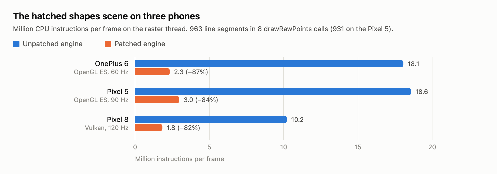
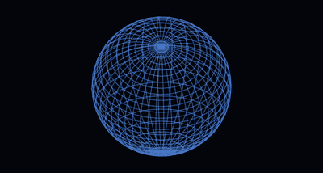

# Flutter line batch bench

A small Flutter app and a runner that measure what it costs to draw straight lines, by the way the lines are handed to the engine. The app draws nothing else, so the numbers are about lines only.

It was written to measure one thing in Impeller. `Canvas.drawPoints` and `Canvas.drawRawPoints` with `PointMode.lines` or `PointMode.polygon` are one call from Dart, but the engine turns the call back into one draw call per segment. A patch that draws the whole call with a single draw is on this branch, as one commit on top of Flutter master:

https://github.com/Pomis/flutter/tree/impeller-batch-drawpoints-lines

## Result

The unpatched and the patched engine on three phones and two Impeller backends:

| Phone | Backend | Screen | Scenes: raster instructions | 800 lines in one call: instructions per frame (M) | 1,600 lines in one call: fps |
|---|---|---|---|---|---|
| OnePlus 6 | OpenGL ES | 60 Hz | -72% to -92% | 14.89 → 1.71 | 59.5 → 59.5 |
| Pixel 5 | OpenGL ES | 90 Hz | -61% to -88% | 16.00 → 2.42 | 71.2 → 89.9 |
| Pixel 8 | Vulkan | 120 Hz | -68% to -90% | 8.35 → 1.44 | 52.2 → 120.0 |

Instructions are CPU instructions on the raster thread, per frame, unpatched → patched. Both engines draw the same pixels in all 37 scenarios on every phone.



## The scenes

Eight small drawings of the kind apps make out of lines, all drawn with `drawRawPoints`, all moving every frame. These are recordings from a phone:

| | |
|---|---|
|  |  |
| **Hatched shapes**: clipped runs of parallel lines, some cross-hatched | **Line chart**: a grid, tick marks and six series as polylines |
|  |  |
| **Graph paper**: thin level and upright lines | **Waveform**: upright bars and their reflection |
|  |  |
| **Starfield**: short streaks in three layers | **Wireframe sphere**: a turning sphere as mesh edges |
|  |  |
| **Long polyline**: one self-crossing curve of 4,000 points | **Rain**: slanted drops in two layers |

Besides the scenes there is a `lines` scenario: one set of plain lines whose number, cap, width, layout and way of drawing are set one at a time.

## The cause and the fix

`DlDispatcherBase::drawPoints` loops over `Canvas::DrawLine` for `PointMode.lines` and `PointMode.polygon`, so every segment becomes an entity and a draw call of its own:

https://github.com/flutter/flutter/blob/2331a7f1961baf285157fc4833dd937643f46c3f/engine/src/flutter/impeller/display_list/dl_dispatcher.cc#L662-L678

`PointMode.points` does not have this problem. It goes through `PointFieldGeometry`, which puts every point into one vertex buffer and one draw.

The patch does the same for lines with a `LineFieldGeometry`: every segment is tessellated the way `LineGeometry` does it, and the strips are joined into one. It keeps the old per-segment loop where one draw could differ from separate draws: hairlines, mask blurs, image and color filters, advanced blend modes and SDF rendering.

## Results in full

Flutter master at `2331a7f`, the engine built locally with and without the patch (`android_profile_arm64`), profile mode. The two engines are installed as two apps and play 37 scenarios against each other: one launch per scenario and engine, the engines alternating, three rounds. Every figure is the middle of the three.

| Phone | Chip | Android | Screen | Impeller backend |
|---|---|---|---|---|
| OnePlus 6 | Snapdragon 845, Adreno 630 | 10 | 60 Hz | OpenGL ES |
| Pixel 5 | Snapdragon 765G, Adreno 620 | 14 | 90 Hz | OpenGL ES |
| Pixel 8 | Tensor G3, Mali-G715 | 16 | 120 Hz | Vulkan |

Unless a table says otherwise, a cell is millions of raster thread instructions per frame, unpatched → patched.

### Scenes

| Scene | OnePlus 6 | Pixel 5 | Pixel 8 |
|---|---|---|---|
| Hatched shapes (963 segments) | 18.06 → 2.33 | 18.58 → 2.98 | 10.22 → 1.84 |
| Line chart (1,903 segments) | 34.55 → 3.57 | 36.68 → 4.46 | 19.66 → 3.16 |
| Graph paper (108 segments) | 2.51 → 0.70 | 2.98 → 1.16 | 1.42 → 0.45 |
| Waveform (548 segments) | 10.13 → 0.85 | 10.72 → 1.31 | 5.53 → 0.58 |
| Starfield (1,500 segments) | 27.43 → 2.78 | 29.49 → 3.55 | 15.51 → 2.44 |
| Wireframe sphere (1,880 segments) | 33.97 → 3.11 | 36.11 → 4.39 | 19.17 → 2.78 |
| Long polyline (3,999 segments) | 71.12 → 5.84 | 76.06 → 9.38 | 40.39 → 5.43 |
| Rain (900 segments) | 16.70 → 1.96 | 17.83 → 2.63 | 9.49 → 1.66 |

Segment counts are from the OnePlus 6. Three scenes fit their line count to the screen, so the hatch, grid and waveform scenes have a few lines fewer on the Pixel 5.


### By the number of lines in one call

Parallel lines, 1.2 px wide, round caps, 70% opaque. Two lines cost the same on both engines, and the gain is there from ten.

| Lines in the call | OnePlus 6 | Pixel 5 | Pixel 8 |
|---|---|---|---|
| 2 | 0.69 → 0.68 | 1.12 → 1.13 | 0.44 → 0.43 |
| 10 | 0.85 → 0.69 | 1.31 → 1.15 | 0.53 → 0.45 |
| 50 | 1.56 → 0.74 | 2.05 → 1.22 | 0.92 → 0.50 |
| 100 | 2.46 → 0.81 | 2.98 → 1.29 | 1.43 → 0.56 |
| 400 | 7.81 → 1.20 | 8.51 → 1.71 | 4.45 → 0.94 |
| 800 | 14.89 → 1.71 | 16.00 → 2.42 | 8.35 → 1.44 |
| 1600 | 29.26 → 2.78 | 31.12 → 3.90 | 16.38 → 2.44 |


### One property changed at a time

800 lines as above, with one thing different. The cell is the change in raster thread instructions.

| 800 lines, but | OnePlus 6 | Pixel 5 | Pixel 8 |
|---|---|---|---|
| 800, butt caps | -94% | -91% | -91% |
| 800, square caps | -94% | -91% | -91% |
| 800, 0.3 px wide | -90% | -86% | -85% |
| 800, 4 px wide | -86% | -80% | -79% |
| 800, 12 px wide | -83% | -77% | -74% |
| 800, crossing | -88% | -85% | -83% |
| 800 short ticks | -88% | -85% | -83% |
| 800, random | -88% | -85% | -83% |
| 800, opaque | -88% | -85% | -83% |
| 800, clipped | -88% | -84% | -83% |
| 800, turned canvas | -88% | -85% | -83% |
| 800 in 40 calls | -84% | -81% | -78% |
| 800 in 200 calls | -65% | -61% | -59% |
| polyline, 800 points | -88% | -85% | -83% |
| polyline, 3000 points | -91% | -89% | -86% |

Splitting the lines over many calls gains less, because each call is still a draw of its own.

### Frames per second

The scenarios where at least one phone missed its screen's rate on the unpatched engine. The cell is frames per second, unpatched → patched.

| Scenario | OnePlus 6 | Pixel 5 | Pixel 8 |
|---|---|---|---|
| Long polyline | 40.0 → 59.6 | 43.9 → 89.9 | 119.6 → 120.0 |
| 800 lines | 59.6 → 59.6 | 90.0 → 89.9 | 112.0 → 120.0 |
| 1600 lines | 59.5 → 59.5 | 71.2 → 89.9 | 52.2 → 120.0 |
| 800, butt caps | 59.5 → 59.5 | 89.9 → 89.9 | 113.5 → 119.9 |
| 800, square caps | 59.6 → 59.5 | 90.0 → 89.9 | 107.1 → 120.0 |
| 800, 0.3 px wide | 59.6 → 59.5 | 90.0 → 89.9 | 112.0 → 120.1 |
| 800, 4 px wide | 59.6 → 59.5 | 90.0 → 89.9 | 101.3 → 120.1 |
| 800, 12 px wide | 59.6 → 59.5 | 81.1 → 89.9 | 88.1 → 120.0 |
| 800, opaque | 59.6 → 59.5 | 90.0 → 89.9 | 112.9 → 119.8 |
| 800 in 40 calls | 59.6 → 59.5 | 89.9 → 89.9 | 110.2 → 120.1 |
| 800 in 200 calls | 59.6 → 59.5 | 89.9 → 89.9 | 112.2 → 120.0 |
| polyline, 3000 points | 46.0 → 59.5 | 52.7 → 89.9 | 103.7 → 119.9 |

### Cases the patch leaves alone, and controls

Hairlines, blurs, color filters and advanced blend modes stay on the per-segment path, and `drawLine`, `drawVertices` and an empty frame are not touched at all. The blurred and overlay rows run at 4 to 19 fps, so their per-frame figures are coarse.

| Scenario | OnePlus 6 | Pixel 5 | Pixel 8 |
|---|---|---|---|
| 800 hairlines (width 0) | 14.88 → 14.89 | 16.00 → 15.97 | 8.40 → 8.46 |
| 100 blurred lines | 145.60 → 150.05 | 217.62 → 211.06 | 66.11 → 70.48 |
| 200 lines, overlay blend | 60.77 → 63.59 | 72.25 → 69.45 | 28.40 → 27.36 |
| 800 lines, color filter | 15.20 → 15.16 | 16.25 → 16.24 | 8.67 → 8.65 |
| empty frame | 0.66 → 0.66 | 1.12 → 1.08 | 0.43 → 0.43 |
| 800 drawLine calls | 15.01 → 15.01 | 16.07 → 16.06 | 8.28 → 8.33 |
| 800 as one drawVertices | 0.71 → 0.72 | 1.17 → 1.13 | 0.47 → 0.47 |

### Stock Flutter, and Impeller off

The released Flutter 3.50.0 on the OnePlus 6, the same 800 lines drawn five ways. One `drawRawPoints(PointMode.lines)` call costs the same as 800 `drawLine` calls.

| 800 lines drawn as | Flutter 3.50.0 | 3.50.0 with Impeller off |
|---|---|---|
| nothing (empty frame) | 0.61 at 60 fps | 0.31 at 60 fps |
| 800 `drawLine` calls | 12.66 at 59 fps | 65.90 at 45 fps |
| one `drawRawPoints(PointMode.lines)` | 12.54 at 59 fps | 64.70 at 47 fps |
| one stroked `Path` with 800 subpaths | 1.73 at 60 fps | 125.60 at 36 fps |
| one `drawVertices` (two triangles per line) | 0.66 at 60 fps | 0.46 at 60 fps |

"Impeller off" is the same build started with `--ez enable-impeller false`, which falls back to the old Skia renderer. It is slower still on this test, so the old renderer is not a way around it.

## Where the time goes

A `simpleperf` call graph of the raster thread, stock Flutter 3.50.0 on the OnePlus 6, 800 lines in one `drawRawPoints` call. The figures are shares of the raster thread's CPU time, callees included. The full summary and two timeline traces are in [`traces/`](traces).

```
86.4%  impeller::RenderToTarget
29.7%    flutter::DisplayList::Dispatch
28.1%      impeller::DlDispatcherBase::drawPoints
28.3%        impeller::Canvas::DrawLine                      (once per segment)
24.2%          impeller::Canvas::AddRenderEntityToCurrentPass
22.2%            impeller::SolidColorContents::Render
 6.6%              impeller::LineGeometry::GetPositionBuffer
56.2%    impeller::ReactorGLES::React
55.1%      impeller::RenderPassGLES::OnEncodeCommands        (one command per segment)
 7.7%        impeller::DeviceBufferGLES::BindAndUploadDataIfNecessary
 7.3%        impeller::PipelineLibrary::LogPipelineUsage     (debug and profile builds only)
 6.2%        impeller::BindVertexBuffer
```

## How the patch was checked

- **On the phones.** Every scenario draws one fixed frame into an image and hashes it. All 37 hashes are equal between the unpatched and the patched engine, on each of the three phones.
- **Existing golden tests.** 28 golden images of the engine's line, polygon and point tests (`DepthValuesForLineMode`, `DepthValuesForPolygonMode`, `CanDrawPoints`, `DrawLinesRenderCorrectly`, `CanRenderLinesWithCapsAnglesAndAlphas`, `CanRenderStrokes` and others) are pixel-identical with and without the patch, on the Metal and the OpenGL ES backend.
- **A new golden test** with crossing translucent lines in all three cap styles, as separate segments, as a polygon and thinner than a pixel. It renders the same through the old loop and through the single draw.
- **The cases the patch leaves alone** cost the same on both engines, as the table above shows.

## Run it

You need Flutter, a phone connected over adb, and an Android NDK for `simpleperf` (only for the counters).

```sh
# One build: the same 800 lines drawn five ways, five rounds.
python3 tool/bench.py run

# The eight scenes, with CPU cycles and instructions per frame.
python3 tool/bench.py run --scenarios scenes --counters

# Any scenario, as the app reads it.
python3 tool/bench.py run --scenarios "lines:n=800,cap=butt|chart"
```

To compare two engines, build the app once on each with its own app id, then play them against each other:

```sh
SRC=~/src/flutter/engine/src
ENGINE="--local-engine=android_profile_arm64 --local-engine-host=host_profile_arm64 --local-engine-src-path=$SRC"

python3 tool/bench.py build --suffix base    --flutter ~/src/flutter/bin/flutter --engine "$ENGINE" -o base.apk
# switch the engine checkout to the other branch, rebuild it, then:
python3 tool/bench.py build --suffix patched --flutter ~/src/flutter/bin/flutter --engine "$ENGINE" -o patched.apk

python3 tool/bench.py pair base=base.apk patched=patched.apk
```

There is also a 60-line version with no options, for a quick look or for pasting into a bug report:

```sh
flutter run --profile -t lib/minimal.dart
```

The full app can also be started by hand. The plan is the start route:

```sh
flutter run --profile --route "/?s=hatch|chart|lines:n=800&seconds=4&rounds=1"
```

Each step prints one `LINEBENCH {json}` line to the log.

## How it measures

- **Instructions and cycles per frame** come from `simpleperf stat --per-thread` on the app's raster thread and UI thread, divided by the frames the app delivered in that window. Instructions do not change when the phone changes its CPU frequency, which makes them the steadiest figure. Cycles and CPU time are in the result files too.
- **CPU time per frame** is read by the app from `/proc/self/task/<tid>/schedstat`. It does not include time the raster thread waits for the screen.
- **Frames per second** is counted from Flutter's own frame timings.
- **The pixel hash** is a hash of one fixed frame of the scenario, drawn by the engine into an image at the screen's size. Two engines that draw a scenario alike give the same hash.
- **Order.** In a single run every round starts one step later than the round before. In a paired run the engines alternate, and which one goes first changes with every scenario.

## Limits

- Three Android phones: OpenGL ES on two Adreno GPUs and Vulkan on one Mali GPU. Metal (iOS, macOS) is not measured.
- Profile builds. In profile and debug mode Impeller also counts pipeline use at every draw, which a release build does not pay.
- Both Pixels reported light thermal throttling by the end of their runs (34 and 39 °C battery). The engines alternate, so both saw it alike, and instruction counts do not depend on it.
- A line set that is mostly off screen is not measured. The unpatched engine can skip such segments one by one; the patched engine draws the whole call if any of it is visible.
- The counters and the CPU time need Android. On other platforms the app still reports frames per second and Flutter's frame timings.
- Only the Android platform folder is checked in. `flutter create --platforms ios,macos .` adds the others.

## Files

- [`lib/main.dart`](lib/main.dart): the whole app. It depends only on Flutter's widgets library.
- [`lib/minimal.dart`](lib/minimal.dart): 800 lines and nothing else, in about 60 lines of code.
- [`tool/bench.py`](tool/bench.py): builds, installs, runs and collects.
- [`tool/charts.py`](tool/charts.py): draws the charts from paired results.
- [`results/`](results): results as JSON, with the lowest and highest round of every figure.
- [`traces/`](traces): a `simpleperf` call-graph summary and two timeline traces (open them at https://ui.perfetto.dev or in chrome://tracing) of stock Flutter 3.50.0.

BSD 3-clause licence, the same as Flutter. See [LICENSE](LICENSE).
